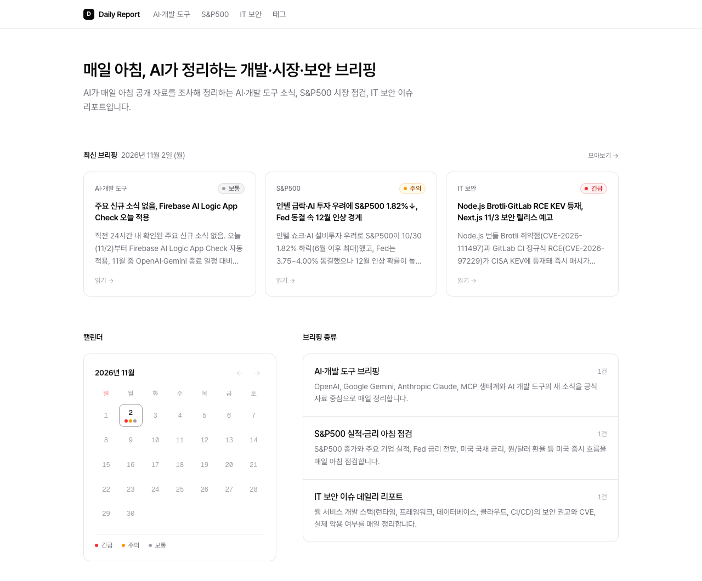
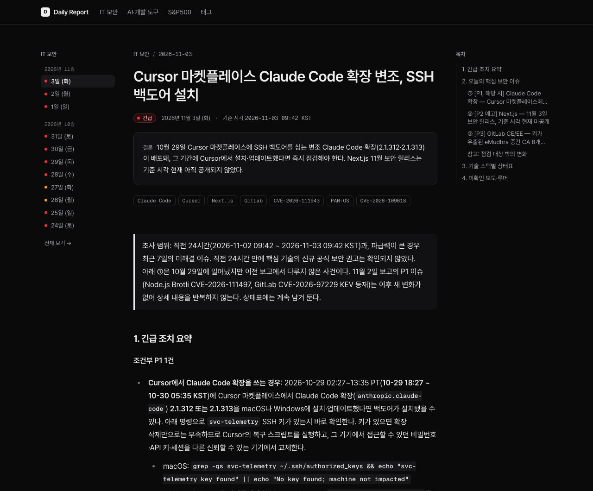
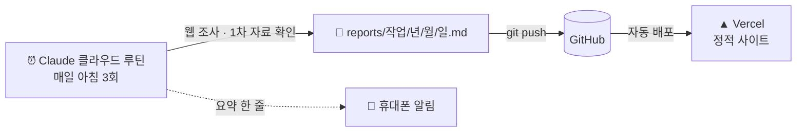
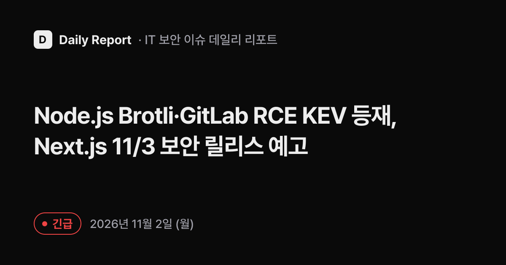

<div align="center">

# Daily Report

**매일 아침, AI가 정리하는 개발·시장·보안 브리핑**

서버도 DB도 없이, AI 에이전트가 매일 웹을 조사해 쓴 보고서를 커밋하면 사이트가 알아서 갱신됩니다.

[**🔗 사이트 바로가기**](https://daily-report-ashy-nine.vercel.app) · [RSS](https://daily-report-ashy-nine.vercel.app/feed.xml) · [태그](https://daily-report-ashy-nine.vercel.app/tags)





</div>

## 📰 매일 받아보는 브리핑 3종

| 시각 (KST) | 브리핑 | 다루는 것 |
|---|---|---|
| 08:30 | **AI·개발 도구** | OpenAI, Gemini, Claude, MCP 생태계와 AI 개발 도구의 새 소식. 백엔드(Node.js·TypeScript) 실무에 주는 영향 |
| 09:00 | **S&P500 실적·금리** | 직전 거래일 종가, 기업 실적, Fed 금리, 미 국채, VIX, 원/달러 환율, 이번 주 일정 |
| 09:30 | **IT 보안 이슈** | 웹 서비스 개발 스택의 CVE·보안 권고, CISA KEV 등재·실제 악용 여부, 패치 버전과 조치 |

보고서마다 `긴급 · 주의 · 보통` 세 단계 판정이 붙어서, 캘린더의 색 점만 봐도 그날 챙길 게 있는지 알 수 있습니다.

## ⚙️ 어떻게 동작하나요



1. **[Claude Code 루틴](https://code.claude.com/docs/en/routines)**이 정해진 시각에 클라우드에서 이 저장소를 받아, [`scheduler/`](scheduler/)의 프롬프트대로 웹을 조사합니다.
2. 결과를 frontmatter가 붙은 Markdown으로 저장해 `main`에 push하고, 휴대폰으로 요약을 보냅니다.
3. push가 들어오면 Vercel이 [`web/`](web/)을 다시 빌드합니다. 모든 페이지는 빌드 시점에 정적으로 만들어집니다.

서버 코드, 데이터베이스, 크롤러가 하나도 없습니다. **데이터는 Git 저장소 자체**입니다.

## ✨ 특징

**믿을 수 있는 보고서를 위한 규칙** ([`scheduler/CLAUDE.md`](scheduler/CLAUDE.md))
- 공식 발표·릴리스 노트·정부 자료 같은 1차 자료를 우선하고, 2차 보도로만 확인된 내용은 "미확인 보도"로 따로 표시합니다.
- 확인되지 않은 수치, 버전, CVE 번호는 만들어내지 않고 "확인 불가"로 적습니다.
- 작성 전에 이전 보고서를 읽어, 이미 다룬 사건은 변화가 있을 때만 다시 다룹니다.

**검색에 잘 걸리는 사이트**
- 루틴이 보고서마다 검색용 제목(`headline`), 설명(`description`), 태그(`tags`)를 함께 뽑습니다.
- 그 값으로 페이지 메타 태그, 공유 이미지(OG), JSON-LD, `sitemap.xml`, RSS를 자동으로 만듭니다.
- 태그별 페이지(`/tags/nodejs`)가 보고서를 주제별로 묶습니다. 보고서가 1건뿐인 태그는 `noindex`로 빈약한 페이지가 색인되는 것을 막습니다.



**한국어 읽기 경험**
- Pretendard + Geist Mono, 단어 단위 줄바꿈(`keep-all`), 시스템 설정을 따르는 다크 모드
- 날짜는 KST 문자열로만 다뤄 UTC 빌드 서버에서 하루가 밀리지 않습니다.
- AI가 쓴 본문은 원시 HTML을 렌더링하지 않습니다.

## 🗂️ 구조

```
daily-report/
├── scheduler/          # 루틴 프롬프트 (공통 규칙 + 작업 3개)
├── reports/            # 루틴이 쓴 보고서 (작업/년/월/일.md)
├── web/                # Next.js 정적 사이트
│   ├── app/            #   홈 · 날짜 · 작업 · 상세 · 태그 · sitemap · RSS · OG
│   └── lib/            #   보고서 읽기·검증, 날짜, 태그 (vitest 단위 테스트)
└── .claude/feature/    # 기능별 기획서와 실행 기록
```

| | |
|---|---|
| 프레임워크 | Next.js 16 (App Router, 전부 SSG) |
| 언어·스타일 | TypeScript, Tailwind CSS 4, @tailwindcss/typography |
| 콘텐츠 | `yaml` (YAML 1.2) + `zod` 검증, `react-markdown` + `remark-gfm` |
| 테스트 | Vitest |
| 자동화 | Claude Code 클라우드 루틴 (Opus) |
| 배포 | Vercel (보고서·사이트 변경이 없으면 빌드 건너뜀) |

## 🧭 작업 방식

이 프로젝트는 AI 코딩 에이전트(Claude Code)와 함께 만들었고, **기능마다 기획서를 먼저 쓰고 실행 결과까지 같은 문서에 남깁니다.**

| 기능 | 기획서 |
|---|---|
| 보고서 사이트 | [`2026-11-02_report-site/plan.md`](.claude/feature/2026-11-02_report-site/plan.md) |
| 태그별 페이지 | [`2026-11-02_tag-pages/plan.md`](.claude/feature/2026-11-02_tag-pages/plan.md) |

기획서에는 결정 사항과 그 이유, 예외 케이스 목록, 계획과 달라진 점, 실제로 돌려 본 검증 결과가 들어 있습니다.

- 브랜치: `feature/*`·`fix/*` → `dev` → `main` (gitflow)
- 커밋: `feature: …`, `fix: …`, `docs: …`, `deploy: …`. 루틴 보고서는 `report(<작업>): <날짜>`
- 사이트 변경이 배포될 때마다 `v0.0.x` 태그

## 🛠️ 로컬에서 실행

```sh
cd web
npm install
npm run dev      # http://localhost:3000
npm test         # 단위 테스트
npm run build    # 정적 빌드
```

보고서는 `../reports`에서 읽습니다. 환경 변수는 [`web/.env.example`](web/.env.example)을, 루틴 설정은 [`scheduler/README.md`](scheduler/README.md)를 참고하세요.

---

<sub>모든 보고서는 AI가 공개 자료를 바탕으로 자동 작성했습니다. 내용이 틀리거나 늦을 수 있으니 중요한 판단 전에는 보고서에 연결된 원문을 확인하세요. 시장 관련 내용은 정보 제공용이며 투자 권유가 아닙니다.</sub>
