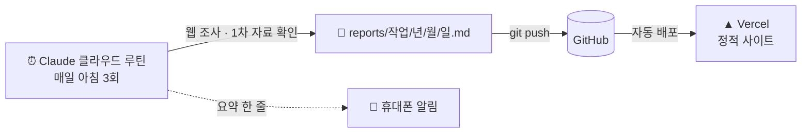

<div align="center">

# Daily Report

**매일 아침, AI가 정리하는 보안·개발·시장 브리핑**

서버도 DB도 없이, AI 에이전트가 매일 웹을 조사해 쓴 보고서를 커밋하면 사이트가 알아서 갱신됩니다.

[**🔗 사이트 바로가기**](https://daily-report-ashy-nine.vercel.app) · [RSS](https://daily-report-ashy-nine.vercel.app/feed.xml) · [태그](https://daily-report-ashy-nine.vercel.app/tags)


</div>

## 📰 매일 받아보는 브리핑 3종

| 시각 (KST) | 브리핑 | 다루는 것 |
|---|---|---|
| 08:25 | **IT 보안 이슈** | 클라우드(AWS) · AI 개발 도구·MCP · 런타임·프레임워크 · 데이터베이스 · 공급망·CI/CD 분야별 CVE·보안 권고, CISA KEV 등재·실제 악용 여부, 패치 버전과 조치 |
| 08:42 | **AI·개발 도구** | OpenAI, Gemini, Claude, MCP 생태계와 AI 개발 도구의 새 소식, 주목할 Agent Skills, 백엔드(Node.js·TypeScript) 적용점 |
| 08:55 | **S&P500 실적·금리** | 직전 거래일 종가, 기업 실적, Fed 금리, 미 국채, VIX, 원/달러 환율, 이번 주 일정 |

보안 리포트 사이의 빈틈은 **3시간마다 도는 후속 확인·긴급 감시 루틴**이 메웁니다. 아침 리포트가 "오늘 중 보안 릴리스 예정"으로 남긴 것이 나오거나, 핵심 기술에 P1급 공지(CISA KEV 신규 등재, 핵심 패키지의 Critical 권고, 인기 패키지 변조, Node.js 보안 릴리스, 핵심 AWS 서비스 공지)가 뜨면 바로 리포트에 덧붙이고 휴대폰으로 알립니다.

보고서마다 `긴급 · 주의 · 보통` 세 단계 판정이 붙어서, 캘린더의 색 점만 봐도 그날 챙길 게 있는지 알 수 있습니다.

## ⚙️ 어떻게 동작하나요



1. **[Claude Code 루틴](https://code.claude.com/docs/en/routines)**이 정해진 시각에 클라우드에서 이 저장소를 받아, [`scheduler/`](scheduler/)의 프롬프트대로 웹을 조사합니다.
2. 결과를 frontmatter가 붙은 Markdown으로 저장해 `main`에 push하고, 휴대폰으로 요약을 보냅니다.
3. push가 들어오면 Vercel이 [`web/`](web/)을 다시 빌드합니다. 모든 페이지는 빌드 시점에 정적으로 만들어집니다.

서버 코드, 데이터베이스, 크롤러가 하나도 없습니다. **데이터는 Git 저장소 자체**입니다.

## ✨ 특징

**믿을 수 있는 보고서를 위한 규칙** ([`scheduler/CLAUDE.md`](scheduler/CLAUDE.md))
- 공식 발표·릴리스 노트·정부 자료 같은 1차 자료를 우선하고, 2차 보도로만 확인된 내용은 "미확인 보도"로 따로 표시합니다.
- 확인되지 않은 수치, 버전, CVE 번호는 만들어내지 않고 "확인 불가"로 적습니다.
- 작성 전에 이전 보고서를 읽어, 이미 다룬 사건은 변화가 있을 때만 다시 다룹니다.

**검색에 잘 걸리는 사이트**
- 루틴이 보고서마다 검색용 제목(`headline`), 설명(`description`), 태그(`tags`)를 함께 뽑습니다.
- 그 값으로 페이지 메타 태그, 공유 이미지(OG), JSON-LD, `sitemap.xml`, RSS를 자동으로 만듭니다.
- 태그별 페이지(`/tags/nodejs`)가 보고서를 주제별로 묶습니다. 보고서가 1건뿐인 태그는 `noindex`로 빈약한 페이지가 색인되는 것을 막습니다.
- 유입은 GA 없이 봅니다. 검색어·노출·순위는 구글 서치 콘솔과 네이버 서치어드바이저, 방문자는 쿠키 없는 Vercel Web Analytics로 집계합니다.


**한국어 읽기 경험**
- Pretendard + Geist Mono, 단어 단위 줄바꿈(`keep-all`), 시스템 설정을 따르는 다크 모드
- 날짜는 KST 문자열로만 다뤄 UTC 빌드 서버에서 하루가 밀리지 않습니다.
- AI가 쓴 본문은 원시 HTML을 렌더링하지 않습니다.
- 넓은 화면에서는 문서 사이트처럼 왼쪽에 같은 보고서의 날짜 목록, 오른쪽에 소제목 목차가 붙고, 지금 읽는 절이 목차에 표시됩니다. 휴대폰에서는 목차가 접힌 상자로 들어갑니다.

## 🔐 내 프로젝트 보안 점검 (Claude Code 스킬)

클라우드 루틴은 내 컴퓨터를 볼 수 없어서, 보안 리포트를 **내 프로젝트에 대 보는 일**은 로컬 스킬 [`security-check`](.claude/skills/security-check/SKILL.md)가 맡습니다. 이 저장소를 연 Claude Code에서 이렇게 말하면 됩니다.

```
보안 점검해 줘
```

1. 최근 보안 리포트에서 취약한 패키지·런타임과 수정 버전을 뽑고
2. 옆에 clone해 둔 프로젝트들의 **lockfile에 실제로 설치된 버전**, Dockerfile·CI의 Node 버전, 이 컴퓨터의 Node 버전과 대조해
3. 프로젝트별로 🔴 즉시 조치 / 🟠 확인 필요 / ✅ 해당 없음과 업데이트 명령을 알려 줍니다.

- **읽기 전용**: 설치·업데이트·커밋을 하지 않습니다. `npm audit`는 의존성 목록이 레지스트리로 전송된다는 안내와 함께 매번 물어본 뒤에만 실행합니다.
- **결과는 저장소 밖**(`<프로젝트 폴더>/security-check/날짜.md`)에만 저장합니다. 저장소 안 경로는 거부합니다.
- 처음 실행할 때 점검 대상을 고릅니다. **자동**(폴더 하나 아래를 모두 찾기)이나 **지정**(흩어진 프로젝트 폴더 목록) 중 하나입니다. 설정은 git에 올라가지 않는 `config.local.json`에 저장되고, "점검 대상 바꿔 줘"로 언제든 바꿀 수 있습니다.
- 다른 프로젝트에서도 쓰려면 사용자 스킬로 링크를 겁니다.
  ```sh
  ln -s "$(pwd)/.claude/skills/security-check" ~/.claude/skills/security-check
  ```

## 🗂️ 구조

```
daily-report/
├── scheduler/          # 루틴 프롬프트 (공통 규칙 + 작업 3개)
├── reports/            # 루틴이 쓴 보고서 (작업/년/월/일.md)
├── watch/              # 보안 후속 확인 대기 목록, 긴급 감시로 알린 기록
├── web/                # Next.js 정적 사이트
│   ├── app/            #   홈 · 날짜 · 작업 · 상세 · 태그 · sitemap · RSS · OG
│   └── lib/            #   보고서 읽기·검증, 날짜, 태그 (vitest 단위 테스트)
├── .claude/skills/     # Claude Code 스킬 (security-check)
├── .claude/feature/    # 기능별 기획서와 실행 기록
└── .github/            # 이슈·PR 템플릿, 보안 정책, 행동 강령, 기여 안내
```

| | |
|---|---|
| 프레임워크 | Next.js 16 (App Router, 전부 SSG) |
| 언어·스타일 | TypeScript, Tailwind CSS 4, @tailwindcss/typography |
| 콘텐츠 | `yaml` (YAML 1.2) + `zod` 검증, `react-markdown` + `remark-gfm` |
| 테스트 | Vitest |
| 자동화 | Claude Code 클라우드 루틴 (Opus) |
| 배포 | Vercel (보고서·사이트 변경이 없으면 빌드 건너뜀) |

## 🧭 작업 방식

이 프로젝트는 AI 코딩 에이전트(Claude Code)와 함께 만들었고, **기능마다 기획서를 먼저 쓰고 실행 결과까지 같은 문서에 남깁니다.**

| 기능 | 기획서 |
|---|---|
| 보고서 사이트 | [`2026-11-02_report-site/plan.md`](.claude/feature/2026-11-02_report-site/plan.md) |
| 태그별 페이지 | [`2026-11-02_tag-pages/plan.md`](.claude/feature/2026-11-02_tag-pages/plan.md) |
| 루틴 다듬기·보안 후속 확인 | [`2026-11-03_routine-tuning/plan.md`](.claude/feature/2026-11-03_routine-tuning/plan.md) |
| 보고서 목차·날짜 목록 | [`2026-11-03_report-toc/plan.md`](.claude/feature/2026-11-03_report-toc/plan.md) |
| 방문 통계 | [`2026-11-03_web-analytics/plan.md`](.claude/feature/2026-11-03_web-analytics/plan.md) |
| 보안 리포트 분야별 확대 | [`2026-11-03_security-categories/plan.md`](.claude/feature/2026-11-03_security-categories/plan.md) |
| 보안 긴급 감시 | [`2026-11-03_security-urgent-watch/plan.md`](.claude/feature/2026-11-03_security-urgent-watch/plan.md) |
| 물결표 취소선 수정 | [`2026-11-03_tilde-strikethrough/plan.md`](.claude/feature/2026-11-03_tilde-strikethrough/plan.md) |
| 라이선스·보안 정책·템플릿 | [`2026-11-03_community-files/plan.md`](.claude/feature/2026-11-03_community-files/plan.md) |

기획서에는 결정 사항과 그 이유, 예외 케이스 목록, 계획과 달라진 점, 실제로 돌려 본 검증 결과가 들어 있습니다.

- 브랜치: `feature/*`·`fix/*` → `dev` → `main` (gitflow)
- 커밋: `feature: …`, `fix: …`, `docs: …`, `deploy: …`. 루틴 보고서는 `report(<작업>): <날짜>`
- 사이트 변경이 배포될 때마다 `v0.0.x` 태그

## 🛠️ 로컬에서 실행

```sh
cd web
npm install
npm run dev      # http://localhost:3000
npm test         # 단위 테스트
npm run build    # 정적 빌드
```

보고서는 `../reports`에서 읽습니다. 환경 변수는 [`web/.env.example`](web/.env.example)을, 루틴 설정은 [`scheduler/README.md`](scheduler/README.md)를 참고하세요.

## 🤝 제보·기여

- 보고서 내용이 틀렸다면: [보고서 정정 요청](https://github.com/iu7726/daily-report/issues/new?template=report-correction.yml)
- 사이트가 이상하다면: [사이트 오류](https://github.com/iu7726/daily-report/issues/new?template=site-bug.yml)
- 다뤘으면 하는 분야나 기능이 있다면: [제안](https://github.com/iu7726/daily-report/issues/new?template=suggestion.yml)
- 보안 문제는 공개 이슈 대신 [보안 정책](.github/SECURITY.md)의 비공개 신고로 알려 주세요.

코드 기여 방법은 [기여 안내](.github/CONTRIBUTING.md)를, 지켜 주실 것은 [행동 강령](.github/CODE_OF_CONDUCT.md)을 봐 주세요.

## 📄 라이선스

- 코드와 루틴 작업 프롬프트: [MIT](LICENSE)
- 보고서 글(`reports/`): [CC BY 4.0](reports/LICENSE). 출처를 밝히면 자유롭게 쓸 수 있습니다. 보고서에 인용한 원문은 각 원저작자의 권리를 따릅니다.

---

<sub>모든 보고서는 AI가 공개 자료를 바탕으로 자동 작성했습니다. 내용이 틀리거나 늦을 수 있으니 중요한 판단 전에는 보고서에 연결된 원문을 확인하세요. 시장 관련 내용은 정보 제공용이며 투자 권유가 아닙니다.</sub>
